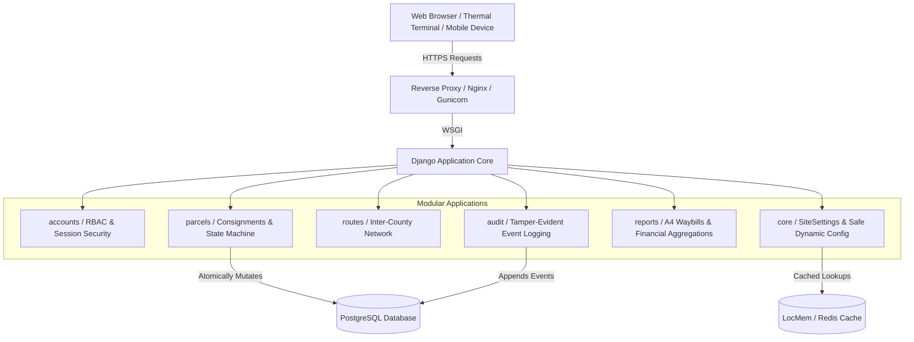

# System Architecture — Northern Highways Transporters Parcel Management System

## 1. Executive Architecture Overview

The **Northern Highways Transporters (NHT) Parcel Management System** is an enterprise-grade bus-parcel and courier logistics platform designed for inter-county transport corridors originating from Nairobi to key northern frontier destinations including Garissa, Wajir, Kotulo, Elwak, Rhamu, Lafey, Arabia, and Mandera.

The system is built on **Python 3.12+**, **Django 5.x**, and **PostgreSQL**, leveraging a strictly modular service-oriented architecture with server-authoritative business logic, cryptographic tracking identifiers, role-based and object-level authorization, comprehensive audit trails, and zero-binary-dependency receipt and reporting engines.



---

## 2. Modular Application Structure

The platform decouples concerns across six discrete Django applications:

| Application | Responsibilities | Key Components |
| :--- | :--- | :--- |
| **`accounts`** | Custom user identity, phone-based staff auth, RBAC groups, role synchronization. | `User`, `Role`, `setup_system_roles_and_groups()`, `login_view()`, `decorators.py` |
| **`routes`** | Inter-county route network, station management, deletion protection for referenced routes. | `Route`, `RouteForm`, route management views |
| **`core`** | System-wide settings (singleton), safe dynamic field & choice configuration, error handlers. | `SiteSettings`, `FieldConfig`, `ChoiceConfig`, error handlers (`400`, `403`, `404`, `500`) |
| **`parcels`** | Parcel registration, items formset, tracking number generator, state transition engine, collection. | `Parcel`, `ShipmentItem`, `ParcelStatusHistory`, `services.py`, `selectors.py`, `utils.py` |
| **`audit`** | Tamper-evident logging of security, authentication, and operational actions with sensitive data sanitization. | `AuditLog`, `log_audit_event()`, `sanitize_dict()`, `get_client_ip()` |
| **`reports`** | Server-side daily waybill statement generation, landscape A4 PDF output, route-level subtotals. | `get_daily_statement_data()`, `generate_daily_statement_pdf_bytes()` |

---

## 3. Strict Separation of Concerns

The codebase rejects "fat models" and "fat views" in favor of clean layer boundaries:

```
Request 
  └──> View Layer (parcels/views.py)
         ├── Authorisation & Scope Check (parcels/selectors.py)
         ├── Input Validation (parcels/forms.py)
         ├── Business Service Orchestration (parcels/services.py)
         │     ├── Database Transaction (transaction.atomic)
         │     ├── Row Lock (select_for_update)
         │     ├── Status Transition & Constraint Validation
         │     └── Audit Logging (audit/services.py)
         └── Presentation (Django Templates / SVG / fpdf2)
```

1. **Models (`models.py`)**: Define schema, field data types, database-level indexes, foreign key deletion protections, and helper boolean properties. No cross-app operational business side-effects are hidden in `save()` overrides.
2. **Forms (`forms.py`)**: Responsible solely for HTTP input parsing, type coercion, and field-level validation (e.g., non-negative prices, positive quantities).
3. **Services (`services.py`)**: Encapsulate critical business operations (`create_parcel`, `update_parcel`, `transition_parcel_status`, `collect_parcel`, `cancel_parcel`). All multi-table updates are wrapped in `transaction.atomic()` blocks.
4. **Selectors (`selectors.py`)**: Query logic for filtering records according to user authorization scopes, preventing Insecure Direct Object References (IDOR).
5. **Views (`views.py`)**: Thin controllers handling HTTP request routing, permission checks, form binding, calling service functions, and returning HTTP responses.

---

## 4. Database Architecture & Concurrency Control

### Exact Decimal Financial Calculations
All monetary values (`unit_price`, `line_total`, `price`, statement subtotals) utilize Python's `decimal.Decimal` and PostgreSQL's native `DECIMAL(12, 2)` datatype. Floating-point arithmetic is strictly prohibited across the entire codebase to eliminate roundoff discrepancies.

### Concurrency & Race-Condition Safeguards
Critical operations that mutate state (such as assigning vehicles, dispatching consignments, or claiming parcels) utilize pessimistic database locks:
```python
parcel = Parcel.objects.select_for_update().get(pk=parcel_id)
```
This guarantees that two station attendants cannot concurrently claim or transition the same consignment.

### Protected Foreign Keys
Routes referenced by parcels employ `on_delete=models.PROTECT`. Attempting to delete a transit route that has historical parcels registered to it is rejected at the database level.

---

## 5. Safe Dynamic Configuration System

The platform fulfills the requirement for dynamic field labels, placeholders, help texts, and dropdown options while enforcing strict data/code segregation:
- **Whitelisted Field Keys**: Only pre-approved parcel fields (`ALLOWED_FIELD_KEYS`) can be configured via `FieldConfig`.
- **Whitelisted Choice Categories**: Dynamic choices are constrained to predefined categories (`wrap_type`, `payment_method`, `payment_status`).
- **No Executable Code**: Dynamic settings are stored as pure text and boolean values in the database. Super Admin cannot inject Python expressions, templates, JavaScript, or raw SQL via the dynamic configuration engine.
- **Cache-Backed Efficiency**: Dynamic field configurations and active choices are cached in memory and automatically invalidated upon administrative edits.

---

## 6. Document Generation Architecture

### 80mm Thermal Receipts
- Generated via a dedicated lightweight template `receipt_80mm.html` styled with `@page { size: 80mm auto; margin: 0; }`.
- Embeds a server-side vector SVG QR code generated with `qrcode.image.svg.SvgPathImage`.
- **Zero Binary C-Library Dependencies**: Operates completely without Pillow or external C-extensions, avoiding compilation failures in containerized or headless environments.
- **Privacy Enforcement**: The QR code encodes *exclusively* the public tracking HTTPS URL. It never embeds private sender ID numbers, cash amounts, or internal staff metadata.

### Daily A4 Consignment Statement (Manifest)
- Implemented in `reports/services.py` using `fpdf2`.
- Formats numbers in compliance with standard East African financial reporting (`KES #,##0.00`).
- Generates downloadable and viewable PDF binaries directly in memory (`io.BytesIO`) without temporary file leakage on disk.
