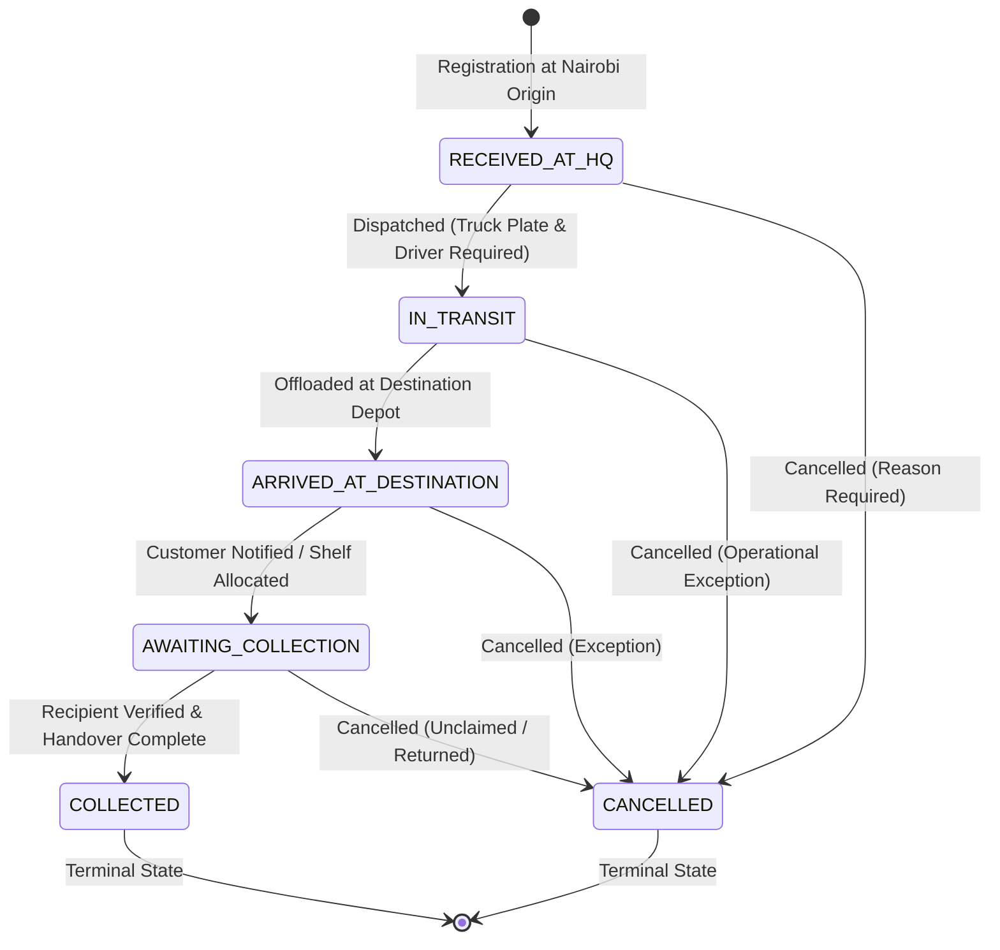

# Consignment Lifecycle & State Machine — Northern Highways Transporters

## 1. Tracking Number Architecture

Northern Highways Transporters assigns a cryptographically random, collision-safe tracking number upon consignment booking:

- **Format**: `NHT-XXXXXXXX` (e.g., `NHT-8FHFU8QU`)
- **Character Set**: Uppercase alphanumeric characters excluding ambiguous glyphs (`0`, `O`, `1`, `I`).
- **Generation Method**: Python's `secrets.choice()` for cryptographic pseudo-random generation.
- **Indexation**: Unique B-Tree index on `parcels_parcel.tracking_number` for sub-millisecond retrieval.
- **Enumeration Resistance**: Tracking numbers cannot be guessed sequentially.

---

## 2. Finite State Machine (FSM)

Consignments move through a strictly validated finite state machine:

### Transition Rules Table

| Initial Status | Permitted Next Statuses | Prerequisites / Validation Checks |
| :--- | :--- | :--- |
| **`RECEIVED_AT_HQ`** | `IN_TRANSIT`, `CANCELLED` | Editable by Counter/Ops Staff. Dispatch requires non-empty `truck_plate_number` and `driver_name`. |
| **`IN_TRANSIT`** | `ARRIVED_AT_DESTINATION`, `CANCELLED` | Editing core parcel data is frozen. Destination or Ops staff must confirm offloading. |
| **`ARRIVED_AT_DESTINATION`** | `AWAITING_COLLECTION`, `CANCELLED` | Consignment placed into secure storage hold; customer notified. |
| **`AWAITING_COLLECTION`** | `COLLECTED`, `CANCELLED` | Collector full name mandatory; recipient ID verified; outstanding COD collected. |
| **`COLLECTED`** | *Terminal* | Immutable. Cannot transition to any other status. Duplicate collection rejected. |
| **`CANCELLED`** | *Terminal* | Immutable. Mandatory cancellation reason audited. |

---

## 3. Operational Lifecyle Stages

### Stage 1: Intake & Consignment Booking (`RECEIVED_AT_HQ`)
- Origin is Nairobi Head Office.
- Counter staff records sender name/phone, recipient name/phone, and recipient national ID/passport number.
- One or more items are added (`description`, `wrap_type`, `quantity`, `unit_price`).
- Total price is atomically calculated using exact Decimal arithmetic (`SUM(qty * unit_price)`).
- An 80mm thermal receipt with an SVG QR code is generated for the customer.

### Stage 2: Vehicle Assignment & Linehaul Dispatch (`IN_TRANSIT`)
- Transport operations staff reviews consignments bound for target routes (e.g., Nairobi to Garissa or Mandera).
- Vehicle registration (e.g., `KDA 982T`) and designated driver name (e.g., `Ali Hassan`) must be entered.
- Server rejects transitions lacking either vehicle plate or driver name.
- Core consignment information becomes frozen from routine edits.

### Stage 3: Destination Arrival (`ARRIVED_AT_DESTINATION`)
- Vehicle arrives at the designated regional terminal (e.g., Wajir Town depot).
- Station attendants verify cargo manifest against offloaded physical goods.
- Station attendant marks consignment as safely arrived.

### Stage 4: Ready for Pickup (`AWAITING_COLLECTION`)
- Parcel is sorted onto station hold shelves.
- Automated or counter notification confirms readiness for collection.

### Stage 5: Recipient Handover & Collection (`COLLECTED`)
- Station attendant inspects recipient's original National ID or Passport.
- Attendant confirms payment status (collects cash/M-Pesa if marked Cash On Delivery).
- Attendant submits collector's full legal name.
- System records `collected_by_name`, `collected_at = timezone.now()`, and creates an immutable status history entry.
- **Race Condition Shield**: Pessimistic lock (`select_for_update()`) ensures concurrent attempts to claim the same consignment fail immediately.

---

## 4. History Tracking & Audit Record

Every successful transition automatically creates a `ParcelStatusHistory` row recording:
- `parcel`: Reference to the consignment
- `old_status`: Previous lifecycle state
- `new_status`: Resulting lifecycle state
- `timestamp`: UTC timestamp of change
- `user`: Authenticated staff member who triggered transition
- `note`: Operational note (e.g., vehicle plate, gate pass, exception note)
- `ip_address`: Client IP address from request header

Normal staff have no ability to edit or delete status history records.
