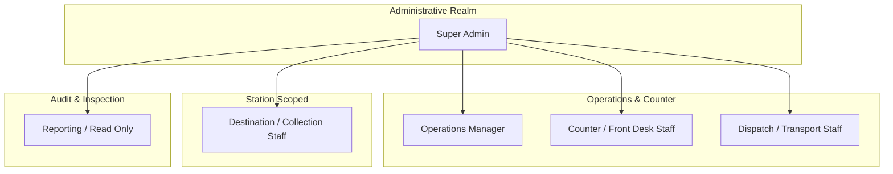

# Role-Based Access Control (RBAC) & Object-Level Security

## 1. Overview

Northern Highways Transporters enforces a dual-layered authorization model:
1. **System Roles & Permissions (RBAC)**: Enforced via Django Groups, model permissions, and role decorators.
2. **Object-Level Scope Boundaries**: Enforced via service-layer and selector queries (`get_parcels_for_user()`, `can_user_access_parcel()`), preventing Insecure Direct Object References (IDOR/BOLA).

---

## 2. Defined Roles & Responsibilities



### 1. Super Admin (`SUPER_ADMIN`)
- **Full Operational & System Oversight**: User lifecycle management (creation, activation/deactivation, role assignment, password resets), route setup, system settings, dynamic form/choice configuration, audit log review.
- **Administrative Override Capability**: Post-dispatch consignment corrections accompanied by mandatory audit reasons.

### 2. Operations Manager (`OPERATIONS_MANAGER`)
- **Network-Wide Operations**: Full visibility of all consignments, parcel creation, pre-dispatch modification, vehicle and driver assignment, status transitions, collection management, daily A4 statements and financial reporting.
- **Restrictions**: Cannot manage users, alter RBAC groups, modify route definitions, or alter system-wide security settings.

### 3. Counter / Front Desk Staff (`COUNTER_STAFF`)
- **Intake & Booking**: Consignment booking at Nairobi head office or counters, editing consignments while `RECEIVED_AT_HQ`, 80mm thermal receipt printing, tracking search, permitted collections.
- **Restrictions**: Cannot edit shipments after dispatch, cannot access admin panel, cannot alter routes or system settings.

### 4. Dispatch / Transport Staff (`DISPATCH_STAFF`)
- **Fleet Assignment & Transit Control**: Access to operational consignments awaiting transit, assignment of bus/truck registration plate numbers and driver names, dispatching to `IN_TRANSIT`.
- **Restrictions**: No modification of financial fees or payment terms; cannot access user management or audit logs.

### 5. Destination / Collection Staff (`DESTINATION_STAFF`)
- **Branch/Station-Level Operations**: Scoped exclusively to parcels destined for their `assigned_route` (e.g., Garissa, Mandera, Wajir). Can mark arrival (`ARRIVED_AT_DESTINATION`), mark awaiting pickup (`AWAITING_COLLECTION`), verify recipient identification, and execute collection (`COLLECTED`).
- **Object-Level Restriction**: Explicitly prohibited from viewing or interacting with consignments assigned to other branches/destinations.

### 6. Reporting / Read Only (`READ_ONLY`)
- **Auditing & Oversight**: Read-only access to operational lists, shipment search, and daily waybill reports.
- **Restrictions**: Cannot mutate any state (no creation, editing, dispatch, or collection).

---

## 3. RBAC Permission Matrix

| Operation / Feature | Super Admin | Operations Manager | Counter Staff | Dispatch Staff | Destination Staff | Read Only |
| :--- | :---: | :---: | :---: | :---: | :---: | :---: |
| **User Management** | ✅ | ❌ | ❌ | ❌ | ❌ | ❌ |
| **Route Management** | ✅ | ❌ | ❌ | ❌ | ❌ | ❌ |
| **System & Dynamic Form Config** | ✅ | ❌ | ❌ | ❌ | ❌ | ❌ |
| **Audit Log Viewing** | ✅ | ❌ | ❌ | ❌ | ❌ | ❌ |
| **Create New Parcel** | ✅ | ✅ | ✅ | ❌ | ❌ | ❌ |
| **Edit Parcel (Before Dispatch)** | ✅ | ✅ | ✅ | ❌ | ❌ | ❌ |
| **Administrative Override (Post-Dispatch)** | ✅ | ❌ | ❌ | ❌ | ❌ | ❌ |
| **Assign Truck & Driver (Dispatch)** | ✅ | ✅ | ❌ | ✅ | ❌ | ❌ |
| **Mark Arrived at Destination** | ✅ | ✅ | ❌ | ❌ | ✅ *(Assigned Route)* | ❌ |
| **Mark Awaiting Collection** | ✅ | ✅ | ❌ | ❌ | ✅ *(Assigned Route)* | ❌ |
| **Complete Recipient Collection** | ✅ | ✅ | ✅ | ❌ | ✅ *(Assigned Route)* | ❌ |
| **Cancel Shipment** | ✅ | ✅ | ❌ | ❌ | ❌ | ❌ |
| **Print 80mm Thermal Receipt** | ✅ | ✅ | ✅ | ✅ | ✅ *(Assigned Route)* | ❌ |
| **View Daily A4 Statement** | ✅ | ✅ | ❌ | ❌ | ❌ | ✅ |
| **View Operational Dashboard** | ✅ | ✅ | ✅ | ✅ | ✅ *(Assigned Route)* | ✅ |
| **View Company Financial Totals** | ✅ | ✅ | ✅ | ❌ | ❌ | ✅ |

---

## 4. Object-Level Security & IDOR Mitigation

### Branch Scoping Implementation
When Destination Staff interact with the system, querysets are filtered at the selector level:
```python
# parcels/selectors.py
def get_parcels_for_user(user, queryset=None):
    if user.role == Role.DESTINATION_STAFF:
        if user.assigned_route:
            return queryset.filter(route=user.assigned_route)
        return queryset.none()
    return queryset
```

### URL Guessing Protection
If a destination attendant attempts to access `/shipments/NHT-MANDERA01/` while assigned to Garissa:
```python
# parcels/selectors.py
def can_user_access_parcel(user, parcel):
    if user.role == Role.DESTINATION_STAFF:
        return user.assigned_route_id is not None and parcel.route_id == user.assigned_route_id
    ...
```
The view triggers `PermissionDenied("You are not authorized to view consignments outside your assigned destination.")`, resulting in a safe HTTP 403 response. Guessing parcel IDs or tracking numbers yields zero data leakage.

---

## 5. Privilege Escalation Defenses

1. **Role Immutability in Forms**: Forms used by non-super-admins omit `role`, `is_staff`, and `is_superuser` fields.
2. **Dedicated Decorator**: All `/admin-panel/` endpoints are wrapped with `@super_admin_required`, rejecting any unauthorized actor before view logic executes.
3. **Safety Mechanism for Last Super Admin**: System prevents a Super Admin from deactivating their own account or stripping their own administrative privileges.
